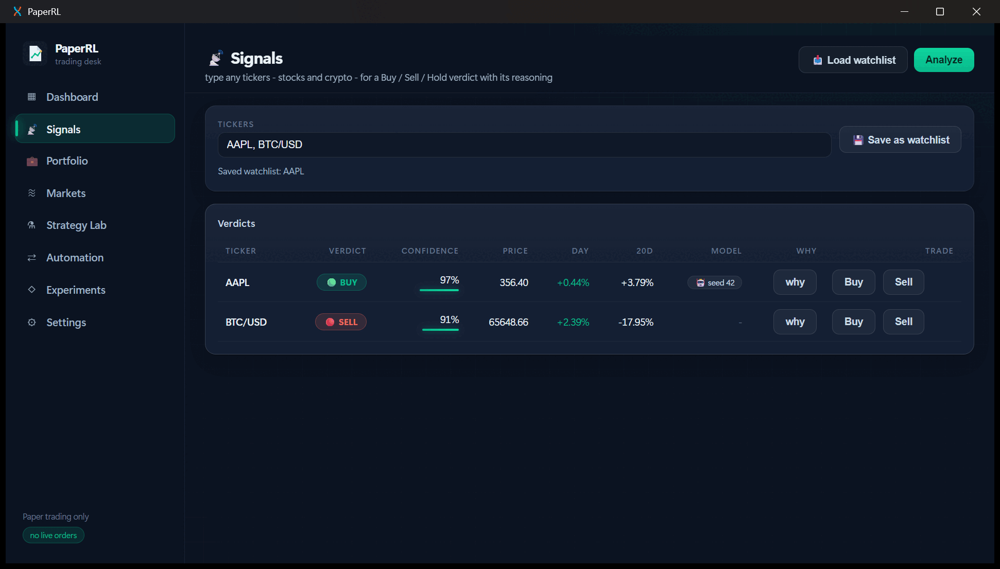

# PaperRL

**A local-first RL trading desk in Rust: reasoned signals, reproducible backtests, paper trades only.**

PaperRL turns a list of tickers into Buy, Sell or Hold verdicts, shows the evidence behind each one, and lets a risk-gated bot act on your watchlist through Alpaca's paper API. The learning, simulator and desktop app are one Rust workspace, with no Python or JavaScript application code.

[](https://www.rust-lang.org)
[](LICENSE)
[](docs/architecture.md#testing)
[](https://alpaca.markets)



## Why PaperRL?

**Verdicts you can audit.** Five factors vote on a weighted score, and an optional PPO checkpoint shifts it. The Signals tab lists every reason, the confidence, the data staleness and the seed of the model that contributed.

**One engine from training to paper.** The RL environment and the backtester share feature code and fill accounting, so a policy is evaluated on the observations it learned from. The workspace has 116 tests, including ones that pin both invariants.

**Paper-only by construction.** The Alpaca client is hardcoded to the paper endpoint. A deterministic risk gate caps position count, position size, order notional and spend, and Stop cancels only orders PaperRL placed.

**Local and reproducible.** Bars live in a Parquet cache, checkpoints save with JSON metadata, and the simulator is deterministic. The same bars and seed give the same result, offline.

## Quick start

Requires a recent stable Rust toolchain (2024 edition). Linux builds also need GTK3, WebKitGTK 4.1, libssl and libxdo development packages; the [release workflow](.github/workflows/release.yml) lists the exact set.

```bash
git clone https://github.com/kingabzpro/PaperRL.git
cd PaperRL

# Alpaca paper keys, used for data, portfolio and orders
export APCA_API_KEY_ID="your-paper-key-id"
export APCA_API_SECRET="your-paper-secret"

cargo run -p paperrl-desktop
```

On PowerShell, set the same variables with `$env:APCA_API_KEY_ID="..."`. The app resolves its data directory at launch (`PAPERRL_HOME`, a repository checkout, or `~/paperrl`) and keeps `config.json`, `logs/` and `models/` there. Backtests, experiments and the Strategy Lab run offline from cached bars.

## Latest benchmark

Trailing six months (2026-05-14 to 2026-11-13), 27 large-cap US stocks, 1 bp fee and 5 bp slippage per trade, seed 42, 300 PPO iterations per stock. Values are means across stocks.

| Strategy | Net return | Max drawdown | Exposure |
|---|---:|---:|---:|
| Volatility targeting | +5.49% | 10.91% | 54.9% |
| Buy & hold, 27 stocks equal weight | +5.30% | 21.07% | 99.2% |
| Mean reversion | +4.44% | 15.45% | 43.5% |
| **Risk-aware PPO** | **+2.43%** | **7.06%** | **34.1%** |
| **SPY buy & hold** | **+1.61%** | **5.86%** | ~100% |
| EMA 10/50 | +1.33% | 11.24% | 36.8% |
| Momentum | -0.83% | 15.64% | 48.4% |

PPO beat SPY on net return in 17 of 27 names and on return per unit of drawdown in 16, with about a third of the exposure. Treat this as a regime check, not a track record: the checkpoints trained on the full three-year range that contains this window, so the comparison is **not strictly out-of-sample**. Six months of one market also says little on its own, and the equal-weight 27-stock row is not SPY.

[Full results and methodology](docs/benchmarks.md) · [CSV](experiments/benchmark-6mo-vs-spy.csv) · [reproduction script](scripts/benchmark_6mo_vs_spy.py)

## Documentation

| Guide | What it covers |
|---|---|
| [Architecture](docs/architecture.md) | crates, data flow, desktop tabs, safety model |
| [Strategies](docs/strategies.md) | signal votes, baselines, PPO environment and reward |
| [Backtesting](docs/backtesting.md) | simulator semantics, metrics, walk-forward methodology |
| [Benchmarks](docs/benchmarks.md) | current and historical results, caveats, per-stock data |
| [Configuration](docs/configuration.md) | CLI reference, config file, environment variables, bot behavior |

## License

MIT. See [LICENSE](LICENSE). Copyright 2026 Abid Ali Awan.

PaperRL is research software. It places orders only on Alpaca paper accounts and is not investment advice.
