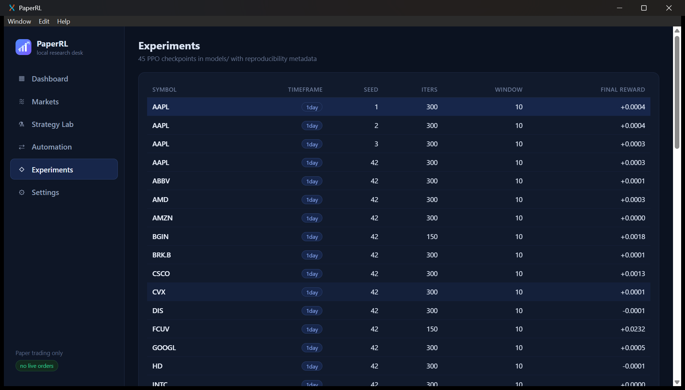

# PaperRL

A local-first trading research platform in Rust: download market data from Alpaca, train risk-aware PPO agents on it, backtest them against classical strategies, and inspect the results. The trading engine, RL training, backtesting, storage, and CLI are all Rust; there is no Python or JavaScript in the application.

## Status

Phases 1 to 3 of the roadmap are built and tested (62 tests, all passing):

- Alpaca market data and paper account adapter (alpacars 0.8.0, pinned; paper API only)
- Parquet bar storage with merge-on-write sync and schema validation
- Deterministic simulator: signal at close, fill at next open, fees in basis points, slippage, no leverage
- Strategies: Buy & Hold, EMA crossover, momentum, mean reversion, volatility targeting, and a PPO policy behind one `Strategy` trait
- Walk-forward evaluation in month-based windows with per-window and aggregate metrics
- Risk-aware PPO on Burn 0.22 (flex CPU backend): five allocation actions (0/25/50/75/100%), regime observations (returns, volatility, volume ratio, MACD histogram, RSI, position, drawdown), reward with cost-aware growth minus excess-drawdown, turnover, and volatility penalties, seeded and reproducible, checkpoints in burnpack with JSON metadata

- Dioxus 0.7 desktop dashboard (`paperrl-desktop`): branded sidebar shell, live paper-account cards, SVG candlestick chart with hover OHLC, strategy comparison and walk-forward tables, a Markets browser over cached datasets, an Experiments page with training curves and one-click model backtests, and an Automation page that runs the same paper-trading pass as the CLI
- Automated paper trading (`paperrl-trade`): momentum screen over the most active universe with liquidity filters, optional per-symbol PPO sizing, a deterministic risk gate, and Alpaca paper order submission with client order IDs, idempotent passes, and an audit log

Not built yet: continuous position reconciliation and monitoring daemon, the experiment manager with redb storage, and Barter integration.

## Results

27 liquid US stocks, three years of daily bars (live Alpaca IEX feed), seed 42, 300 PPO iterations per stock, 1 bp fee and 5 bp slippage on every trade. Mean across stocks:

| Strategy | Net return | Max drawdown | Exposure |
|---|---|---|---|
| Buy & Hold | 78.82% | 33.89% | 99.9% |
| Volatility targeting | 40.50% | | |
| Risk-aware PPO | 31.44% | 15.48% | 42.6% |
| Momentum | 30.20% | | |
| EMA 10/50 | 28.28% | | |
| Mean reversion | 24.71% | | |

PPO leads every baseline beside Buy & Hold and volatility targeting on raw return, trading 26 of 27 stocks with less than half of Buy & Hold's exposure and drawdown. Across six walk-forward windows per stock it also produced the most stable results: mean window return +3.15% with a 6.71% window stdev and the mildest worst window (-5.26%), against Buy & Hold's +11.29% mean but 22.14% stdev and -14.18% worst window.

Seed spreads on five stocks show the variation the architecture doc asked to record: NVDA ranges 129% to 193% across seeds, AAPL 43.6% to 65.4%, JPM 60.1% to 90.2%, WMT 74.5% to 111.8%, while KO converged identically.

Read these numbers with the caveats they deserve. Three years of a bull-heavy sample favor Buy & Hold; the PPO walk-forward windows are not strictly out-of-sample because the agent trained on the full range; and drawdown and exposure were only recorded for Buy & Hold and PPO in this run. The full per-stock data is in `experiments/`, including `benchmark-27stocks-v2-risk-aware-ppo.csv`, `seeds-5stocks-v2.csv`, and `walkforward-27stocks-v2.csv`.

## Automated paper trading

Two commands cover the workflow. Both require `APCA_API_KEY_ID` / `APCA_API_SECRET` and use the paper endpoint only.

```
# Screen the top 100 most active symbols and train this year's PPO models for the top 3 gainers
paperrl trade scan --top 100 --train-top 3 --iters 150 --since 2026-01-01

# Plan one pass (dry run by default)
paperrl trade auto --top 100 --long 3

# Submit the planned orders to the paper account (explicit activation)
paperrl trade auto --top 100 --long 3 --execute

# Keep running every five minutes until stopped
paperrl trade auto --top 100 --long 3 --execute --interval 300
```

How a pass works: it pulls the screener's most active symbols plus current movers, refreshes daily bars for anything missing or older than five days, ranks the universe by blended 20-day and 5-day momentum, sells positions whose momentum turned or dropped out of the top list, and buys the leading gainers. Liquidity filters drop names below $5 or under $2M average daily dollar volume, which keeps penny stocks and warrants out. When a `ppo-SYMBOL-42.bpk` checkpoint exists, its current target weight scales that symbol's allocation; otherwise the planner uses half of the per-position cap.

The risk gate caps position count, per-position size as a fraction of equity, per-order notional, and total spend by available cash; it never uses leverage. Symbols with open orders are treated as held, so re-running a pass cannot duplicate a buy or a sell. Every submitted order carries a `paperrl-` client order ID and is appended to `logs/orders.csv`.

Live verification on 2026-11-15: a scan over a 190-symbol universe (most actives plus movers) ranked the leaders and trained three this-year models; the first automated pass submitted three paper buys of $2,000 each, all Accepted, and the account's buying power dropped by exactly $6,000 while positions stayed empty because the market was closed. A second pass immediately afterwards planned zero orders.

Known limits: leveraged single-stock ETFs (TSLL, TSLG and similar) pass the price and volume filters and can dominate momentum rankings; add an exclusion list before treating the paper results as investment evidence. Orders submitted outside market hours are queued by Alpaca for the next session.

## Desktop dashboard




```
cargo run -p paperrl-desktop
```

Five pages share the CLI's engine crates:

| Page | What it shows |
|---|---|
| Dashboard | selected dataset stats, last 120 candles with hover OHLC and a volume strip, the live paper-account card, and a strategy comparison with PPO included when a checkpoint exists |
| Markets | every cached dataset with bar counts and date ranges; click to chart it |
| Strategy Lab | editable cash, fee, and slippage; run the full comparison and six-month walk-forward aggregates |
| Experiments | checkpoints with seed, iterations, window, final reward, training-curve sparkline, and one-click backtest against the baselines |
| Settings | paths, credential status, and the paper-only safety model |

The window launched and the account card fetched the live paper account in a smoke run; automated tests cover the data layer (dataset scanning, chart geometry, sparklines, money formatting).

## Speed

Measured on this development machine (Windows, release build, CPU flex backend):

| Operation | Wall time | Notes |
|---|---|---|
| Sync 25 symbols, 3 years of daily bars | ~7 s | one paginated request per symbol, Alpaca rate limits dominate |
| Train PPO, 300 iterations (~155k steps) | 9.7 s | includes rollout collection and 1,200 minibatch updates |
| Backtest one stock, 6 strategies, 750 bars | 32 ms | deterministic, same simulator for every strategy |
| Walk-forward one stock, 4 strategies, 6 windows | 30 ms | per-window metrics and aggregates |
| Full 27-stock sweep (train plus backtest) | ~4.5 min | the run behind the table above |

## Quickstart

Set your Alpaca paper keys in the environment (they are only needed for data sync and account commands):

```
setx APCA_API_KEY_ID "your_paper_key"
setx APCA_API_SECRET "your_paper_secret"
```

Download, train, and compare:

```
paperrl data sync --symbols AAPL,MSFT --years 3
paperrl data show --symbol AAPL --limit 5
paperrl train --symbol AAPL --iters 300 --seed 42 --window 10
paperrl backtest --symbol AAPL --strategies buyhold,ema,momentum,meanrev,voltarget,ppo --model models/ppo-AAPL-42.bpk
paperrl backtest --symbol AAPL --strategies buyhold,voltarget,ppo --model models/ppo-AAPL-42.bpk --window-months 6
paperrl alpaca account
```

Training and backtesting work offline from the cached Parquet datasets; only sync and account commands touch the network. The trading client is hardcoded to Alpaca's paper endpoint, so the live-money API is unreachable by construction.

## Workspace

| Crate | What it holds |
| --- | --- |
| paperrl-core | Bar, Symbol, Timeframe, shared error type |
| paperrl-alpaca | Alpaca REST adapter (data + paper account) |
| paperrl-data | BarStore: one Parquet file per (timeframe, symbol) |
| paperrl-sim | Simulator, Portfolio accounting, strategies, walk-forward |
| paperrl-rl | Feature engine, TradingEnv, and the PPO agent |
| paperrl-cli | The `paperrl` binary |
| paperrl-trade | Momentum screen, risk gate, paper executor |
| paperrl-desktop | Dioxus dashboard |

Datasets land in `datasets/`, model checkpoints and their JSON metadata in `models/`. Both are gitignored.

## Design notes

The simulator and the RL environment share one fill-accounting implementation (`paperrl_sim::Portfolio`), and the training environment and backtest strategies share one feature engine (`paperrl_rl::features`), so a policy sees identical observations in training and evaluation; tests pin both invariants. Model metadata records the symbol, timeframe, window, seed, environment shaping, and the full training curve, and the backtester refuses a model trained on a different symbol.

The reward follows the environment design in the research roadmap: cost-aware log growth minus penalties for drawdown increases beyond a 15% threshold, turnover, and position-weighted volatility. The penalty weights are calibrated empirically, not inherited: a diagnostic must show positive mean reward for a full-position hold on an uptrending stock (AAPL: +0.000282 per step) and negative on a losing one (PEP: -0.001559 per step). Earlier defaults failed that check and the agent correctly learned to never invest.
