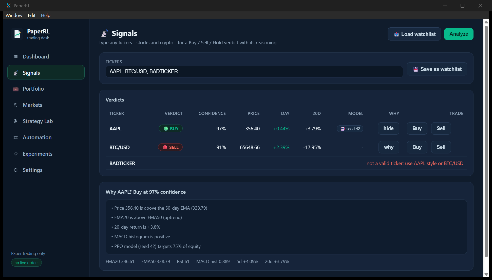
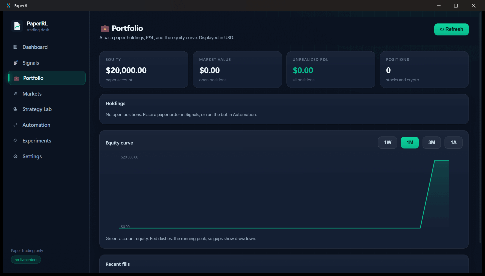
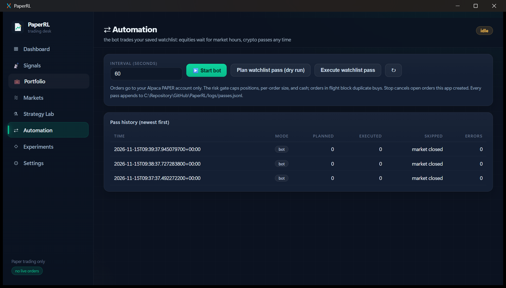
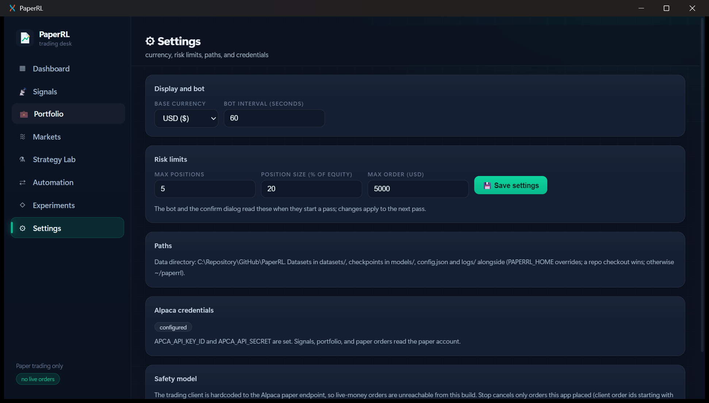
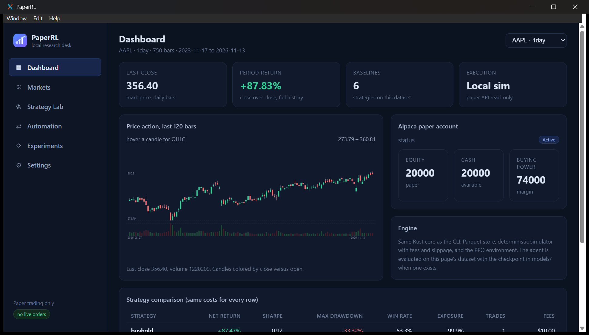

# PaperRL

A local-first trading app in Rust: type any tickers (stocks and crypto) and get Buy / Sell / Hold verdicts with the reasoning shown, run a paper-trading bot on a schedule from inside the app, and track the portfolio it builds. The trading engine, RL training, backtesting, storage, UI, and CLI are all Rust; there is no Python or JavaScript in the application.

## Status

Built and tested (113 tests, all passing):

- Alpaca adapter (alpacars 0.8.0, pinned; paper API only): account, positions with cost basis, portfolio history, fills, market clock, screener, stock and crypto bars, FX rates, buy and sell orders, and cancel-by-client-prefix
- Parquet bar storage with merge-on-write sync and schema validation; crypto pairs cache as BTC-USD.parquet
- Deterministic simulator: signal at close, fill at next open, fees in basis points, slippage, no leverage
- Strategies: Buy & Hold, EMA crossover, momentum, mean reversion, volatility targeting, and a PPO policy behind one `Strategy` trait
- Walk-forward evaluation in month-based windows with per-window and aggregate metrics
- Risk-aware PPO on Burn 0.22 (flex CPU backend): five allocation actions (0/25/50/75/100%), regime observations (returns, volatility, volume ratio, MACD histogram, RSI, position, drawdown), reward with cost-aware growth minus excess-drawdown, turnover, and volatility penalties, seeded and reproducible, checkpoints in burnpack with JSON metadata
- Recommendation engine (`paperrl-trade::recommend`): weighted vote over trend (price vs EMA50, EMA20 vs EMA50), 20-day momentum, MACD histogram, and RSI bands, returning Buy / Sell / Hold with a 0.5 to 1.0 confidence, human-readable reasons, and a PPO checkpoint overlay labeled with its seed
- In-app trading bot (`paperrl-trade::spawn_bot`): trades the user's saved watchlist, skips equities while the market is closed (crypto passes any time), appends every pass to `logs/passes.jsonl`, and cancels only its own orders on stop (client order ids starting with `paperrl-`)
- Dioxus 0.7 desktop app (`paperrl-desktop`): eight tabs covering signals, portfolio, automation, markets, lab, experiments, and settings; config and watchlist persist to `config.json`; logging goes to console and `<home>/logs/app.log`

Not built yet: continuous position reconciliation and monitoring while the app is closed, the experiment manager with redb storage, and Barter integration.

## Results

27 liquid US stocks, three years of daily bars (live Alpaca IEX feed), seed 42, 300 PPO iterations per stock, 1 bp fee and 5 bp slippage on every trade. Mean across stocks:

| Strategy | Net return | Max drawdown | Exposure |
|---|---|---|---|
| Buy & Hold | 78.82% | 33.89% | 99.9% |
| Volatility targeting | 40.50% | | |
| Risk-aware PPO | 31.44% | 15.48% | 42.6% |
| Momentum | 30.20% | | |
| EMA 10/50 | 28.28% | | |
| Mean reversion | 24.71% | | |

PPO leads every baseline beside Buy & Hold and volatility targeting on raw return, trading 26 of 27 stocks with less than half of Buy & Hold's exposure and drawdown. Across six walk-forward windows per stock it also produced the most stable results: mean window return +3.15% with a 6.71% window stdev and the mildest worst window (-5.26%), against Buy & Hold's +11.29% mean but 22.14% stdev and -14.18% worst window.

Seed spreads on five stocks show the variation the architecture doc asked to record: NVDA ranges 129% to 193% across seeds, AAPL 43.6% to 65.4%, JPM 60.1% to 90.2%, WMT 74.5% to 111.8%, while KO converged identically.

Read these numbers with the caveats they deserve. Three years of a bull-heavy sample favor Buy & Hold; the PPO walk-forward windows are not strictly out-of-sample because the agent trained on the full range; and drawdown and exposure were only recorded for Buy & Hold and PPO in this run. The full per-stock data is in `experiments/`, including `benchmark-27stocks-v2-risk-aware-ppo.csv`, `seeds-5stocks-v2.csv`, and `walkforward-27stocks-v2.csv`.

## Last six months versus SPY

The same 27 stocks, every strategy, and each stock's PPO checkpoint, run over the trailing six months (2026-05-14 to 2026-11-13) and compared against SPY buy-and-hold on the same dates. Mean across stocks; 1 bp fee and 5 bp slippage everywhere:

| Strategy | Net return | Max drawdown | Exposure |
|---|---|---|---|
| Buy & Hold (27 stocks, equal weight) | +5.30% | 21.07% | ~99% |
| Volatility targeting | +5.49% | 10.91% | ~62% |
| Mean reversion | +4.44% | 15.45% | ~34% |
| Risk-aware PPO | +2.43% | 7.06% | ~47% |
| EMA 10/50 | +1.33% | 11.24% | ~50% |
| **SPY buy & hold** | **+1.61%** | **5.86%** | ~99% |
| Momentum | -0.83% | 15.64% | ~59% |

This window was choppy: SPY returned +1.61% with a 5.86% drawdown. Equal-weight Buy & Hold of the 27 names beat SPY on return but took 3.6 times the drawdown, and the mega-cap dispersion was extreme (MSFT +26.4% and ABBV +38.7% while GOOGL fell 25.3% and NVDA 29.2%). Risk-aware PPO beat SPY on return in 17 of 27 stocks and on return-per-drawdown in 16 of 27, with its best work on the falling names: NVDA's buy-and-hold lost 29.2% with a 31.9% drawdown while the agent sat mostly out and lost 6.2% with an 8.6% drawdown. Plain momentum was negative on average in this regime, which is recorded here as-is. Per-stock data is in `experiments/benchmark-6mo-vs-spy.csv`, generated by `scripts/benchmark_6mo_vs_spy.py`.

Caveats: the PPO checkpoints trained on the full three-year range, so this window is not out-of-sample for them; the 27-stock Buy & Hold row is an equal-weight average while SPY is cap-weighted; and six months is a short, single-regime sample that proves little on its own.

## Trading the watchlist

The app's bot trades what you save in the Signals tab. Equities wait for market hours (the Alpaca clock gates each pass) and crypto pairs are entered any time. Every pass appends one JSON line to `logs/passes.jsonl` with what was planned, executed, skipped, and any errors, so the Automation tab shows a full pass history. Stop cancels open orders the app created and leaves orders placed elsewhere untouched.

Live verification on 2026-11-15 (a Sunday, market closed): the Signals tab analyzed `AAPL, BTC/USD, BADTICKER` and returned a Buy at 97% confidence for AAPL (with the reasoning card: price above the 50-day EMA, EMA20 over EMA50, +3.8% 20-day return, positive MACD histogram, PPO overlay), a Sell at 91% for BTC/USD through the crypto data path, and an inline error for the bad ticker. A bot started with a 60-second interval produced three history entries all marked `skipped: market closed`, and Stop returned the chip to idle. With EUR selected as base currency and the free Alpaca plan declining FX rates (HTTP 403), the app fell back to US dollars with a visible note. The portable exe launched from a directory with no data nearby and created `%USERPROFILE%\paperrl` on first run.

## Automated paper trading (CLI)

The CLI keeps the screener workflow. Both commands require `APCA_API_KEY_ID` / `APCA_API_SECRET` and use the paper endpoint only.

```
# Screen the top 100 most active symbols and train this year's PPO models for the top 3 gainers
paperrl trade scan --top 100 --train-top 3 --iters 150 --since 2026-01-01

# Plan one pass (dry run by default)
paperrl trade auto --top 100 --long 3

# Submit the planned orders to the paper account (explicit activation)
paperrl trade auto --top 100 --long 3 --execute

# Keep running every five minutes until stopped
paperrl trade auto --top 100 --long 3 --execute --interval 300
```

How a pass works: it pulls the screener's most active symbols plus current movers, refreshes daily bars for anything missing or older than five days, ranks the universe by blended 20-day and 5-day momentum, sells positions whose momentum turned or dropped out of the top list, and buys the leading gainers. Liquidity filters drop names below $5 or under $2M average daily dollar volume, which keeps penny stocks and warrants out. When a checkpoint for a symbol exists, the newest one by file time scales that symbol's allocation; otherwise the planner uses half of the per-position cap.

The risk gate caps position count, per-position size as a fraction of equity, per-order notional, and total spend by available cash; it never uses leverage. Symbols with open orders are treated as held, so re-running a pass cannot duplicate a buy or a sell. Every submitted order carries a `paperrl-` client order ID and is appended to `logs/orders.csv`.

Earlier verification the same day: a scan over a 190-symbol universe ranked the leaders and trained three this-year models; the first automated pass submitted three paper buys of $2,000 each, all Accepted, and the account's buying power dropped by exactly $6,000 while positions stayed empty because the market was closed. A second pass immediately afterwards planned zero orders.

Known limits: leveraged single-stock ETFs (TSLL, TSLG and similar) pass the price and volume filters and can dominate momentum rankings; add an exclusion list before treating the paper results as investment evidence. Orders submitted outside market hours are queued by Alpaca for the next session. Crypto signals are rules-only today; no PPO checkpoint has been trained on crypto bars yet.

## Desktop app











```
cargo run -p paperrl-desktop
```

Eight tabs share the engine crates:

| Tab | What it shows |
|---|---|
| Dashboard | market clock banner, the live paper-account card refreshing every 30 seconds, dataset stats, candles with hover OHLC, and a strategy comparison |
| Signals | type any tickers (stocks and crypto), get a Buy / Sell / Hold badge with confidence, price, day and 20-day change, a "why" card listing every contributing factor, a cached-data chip, and Buy / Sell buttons with a confirm dialog that place paper orders |
| Portfolio | holdings with avg entry, current price, market value, unrealized P&L and percent, weight per position, currency exposure (equities vs crypto), an equity curve with drawdown line over 1W / 1M / 3M / 1A, and recent fills |
| Markets | every cached dataset with bar counts and date ranges; click to chart it |
| Strategy Lab | editable cash, fee, and slippage with input validation; run the full comparison and six-month walk-forward aggregates |
| Automation | bot start/stop with interval and risk limits, live state chip, pass history from `passes.jsonl`, and the manual watchlist pass (dry run or execute) |
| Experiments | checkpoints with seed, iterations, window, final reward, training-curve sparkline, and one-click backtest against the baselines |
| Settings | base currency (18 codes), bot interval, risk limits, data directory, credential status, and the paper-only safety model |

All money renders through one formatter; with a non-USD base currency it converts at the latest FX rate, and when the rate is unavailable it falls back to dollars with a visible note. Cost basis stays in USD because Alpaca settles in USD.

The app resolves its data directory in this order: the `PAPERRL_HOME` environment variable, a repository checkout (a `datasets` folder beside the working directory), or `%USERPROFILE%\paperrl`. The CLI resolves paths the same way.

## Speed

Measured on this development machine (Windows, release build, CPU flex backend):

| Operation | Wall time | Notes |
|---|---|---|
| Sync 25 symbols, 3 years of daily bars | ~7 s | one paginated request per symbol, Alpaca rate limits dominate |
| Train PPO, 300 iterations (~155k steps) | 9.7 s | includes rollout collection and 1,200 minibatch updates |
| Backtest one stock, 6 strategies, 750 bars | 32 ms | deterministic, same simulator for every strategy |
| Walk-forward one stock, 4 strategies, 6 windows | 30 ms | per-window metrics and aggregates |
| Full 27-stock sweep (train plus backtest) | ~4.5 min | the run behind the table above |

## Quickstart

Set your Alpaca paper keys in the environment (they are only needed for data sync and account commands):

```
setx APCA_API_KEY_ID "your_paper_key"
setx APCA_API_SECRET "your_paper_secret"
```

Download, train, and compare:

```
paperrl data sync --symbols AAPL,MSFT --years 3
paperrl data show --symbol AAPL --limit 5
paperrl train --symbol AAPL --iters 300 --seed 42 --window 10
paperrl backtest --symbol AAPL --strategies buyhold,ema,momentum,meanrev,voltarget,ppo --model models/ppo-AAPL-42.bpk
paperrl backtest --symbol AAPL --strategies buyhold,voltarget,ppo --model models/ppo-AAPL-42.bpk --window-months 6
paperrl alpaca account
```

Training and backtesting work offline from the cached Parquet datasets; only sync and account commands touch the network. The trading client is hardcoded to Alpaca's paper endpoint, so the live-money API is unreachable by construction.

## Workspace

| Crate | What it holds |
| --- | --- |
| paperrl-core | Bar, Symbol (equities and crypto pairs), AssetClass, currency helpers, shared error type |
| paperrl-alpaca | Alpaca REST adapter: data, screener, paper account, portfolio history, fills, clock, FX, crypto bars, orders on both sides |
| paperrl-data | BarStore: one Parquet file per (timeframe, symbol); shared data-directory resolution |
| paperrl-sim | Simulator, Portfolio accounting, strategies, walk-forward |
| paperrl-rl | Feature engine, TradingEnv, and the PPO agent |
| paperrl-cli | The `paperrl` binary |
| paperrl-trade | Recommendation engine, momentum screen, risk gate, watchlist bot scheduler, app config |
| paperrl-desktop | Dioxus trading app |

Datasets land in `datasets/`, model checkpoints and their JSON metadata in `models/`. Both are gitignored.

## Design notes

The simulator and the RL environment share one fill-accounting implementation (`paperrl_sim::Portfolio`), and the training environment and backtest strategies share one feature engine (`paperrl_rl::features`), so a policy sees identical observations in training and evaluation; tests pin both invariants. Model metadata records the symbol, timeframe, window, seed, environment shaping, and the full training curve, and the backtester refuses a model trained on a different symbol.

The reward follows the environment design in the research roadmap: cost-aware log growth minus penalties for drawdown increases beyond a 15% threshold, turnover, and position-weighted volatility. The penalty weights are calibrated empirically, not inherited: a diagnostic must show positive mean reward for a full-position hold on an uptrending stock (AAPL: +0.000282 per step) and negative on a losing one (PEP: -0.001559 per step). Earlier defaults failed that check and the agent correctly learned to never invest.
