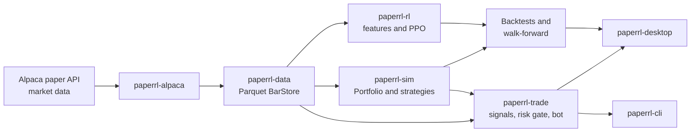
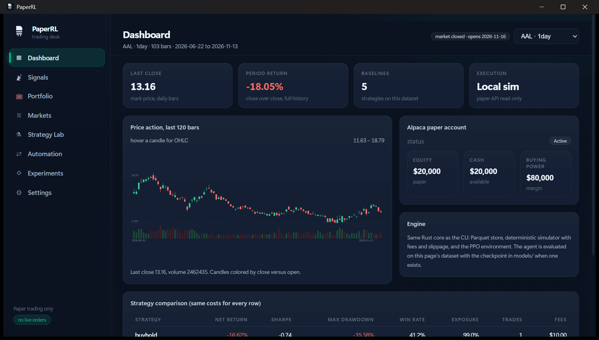
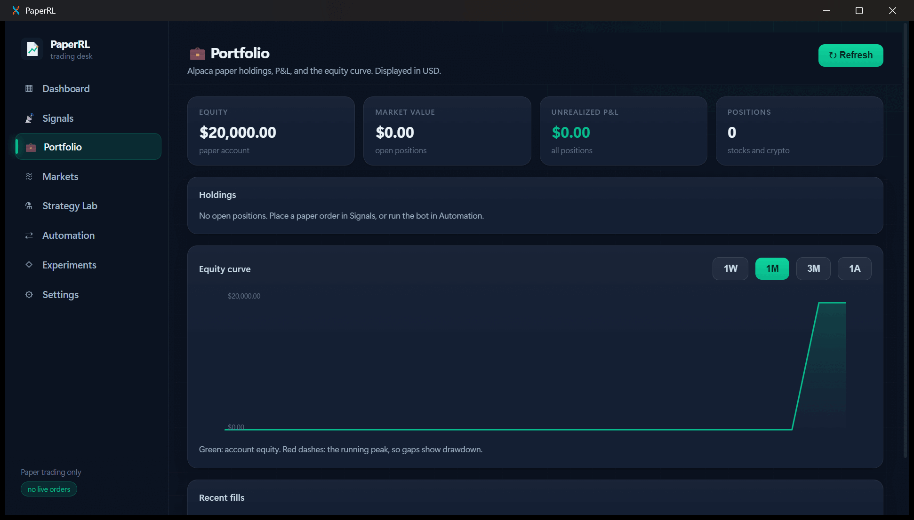
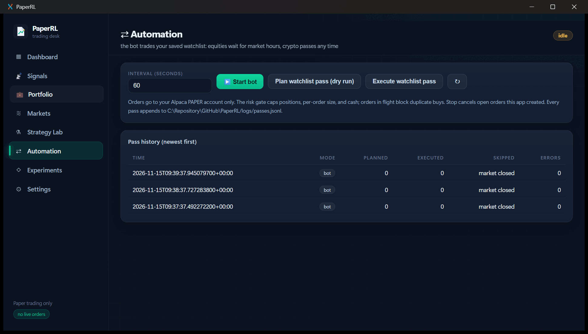
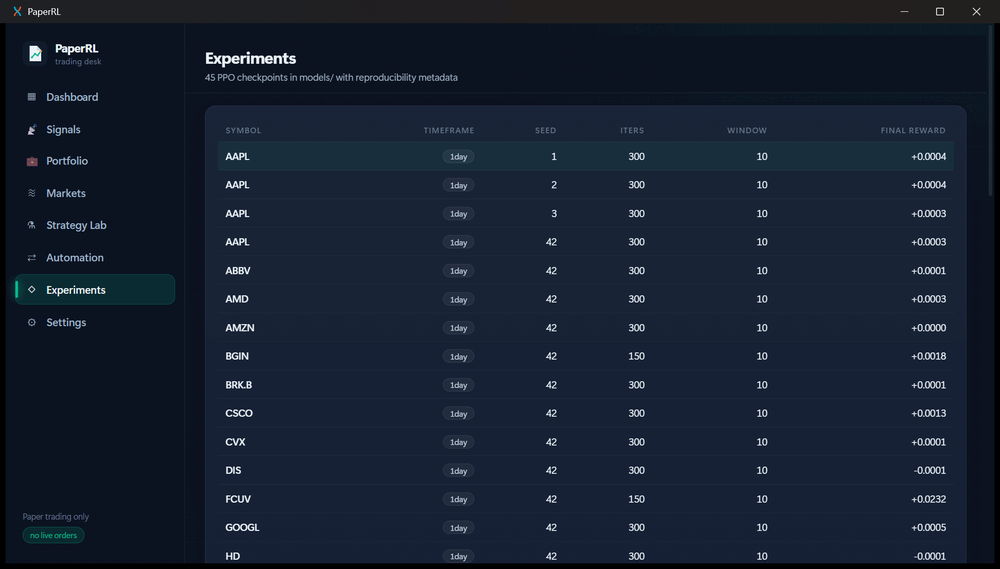
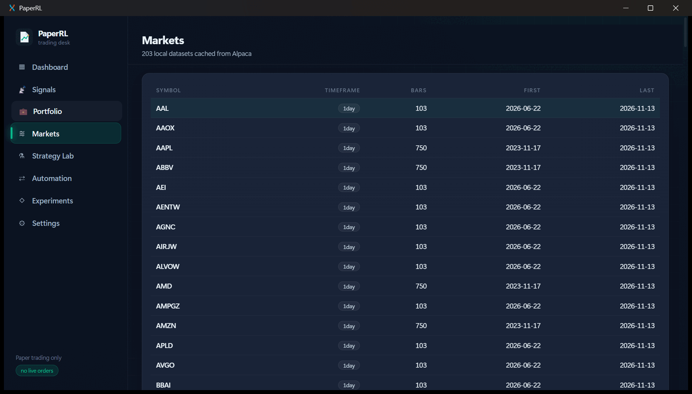
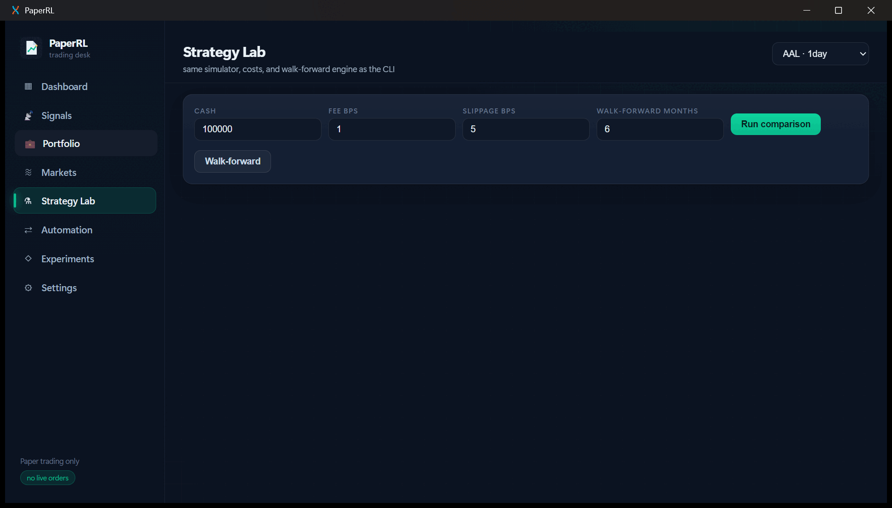

# Architecture

PaperRL is a Cargo workspace of eight crates. The Dioxus desktop app and the `paperrl` CLI are two front ends over the same engine. Market data comes from Alpaca and lands in a local Parquet store, which feeds one simulator shared by backtests and reinforcement learning.

## Crates

| Crate | Responsibility |
|---|---|
| `paperrl-core` | `Bar`, `Symbol` (equities and crypto pairs), `AssetClass`, currency types, shared error type |
| `paperrl-alpaca` | Alpaca REST adapter, pinned to `alpacars =0.8.0` and isolated behind this crate: bars, crypto bars, screener, paper account, portfolio history, fills, clock, FX, buy and sell orders, cancel by client prefix |
| `paperrl-data` | `BarStore`: one Parquet file per timeframe and symbol, merge-on-write sync, schema validation, shared data-directory resolution |
| `paperrl-sim` | `Portfolio` accounting, deterministic simulator, rule strategies, walk-forward evaluation |
| `paperrl-rl` | Feature engine, `TradingEnv`, PPO implemented on Burn 0.22 with the flex CPU backend |
| `paperrl-trade` | Recommendation engine, momentum screen, risk gate, watchlist bot, app config |
| `paperrl-cli` | The `paperrl` binary |
| `paperrl-desktop` | Dioxus 0.7 desktop application |

## Data flow



A signal request parses the symbol, ensures its bars are cached (fetching from the stock or crypto feed when missing or stale), computes indicators, looks for a PPO checkpoint, and returns a `Recommendation`. The bot loop uses the same signal path, then plans orders through the risk gate.

## Shared invariants

Three design choices keep research and live signals comparable.

- `paperrl_sim::Portfolio` handles fills for both the batch simulator and `TradingEnv`. An action is a target equity weight set at a bar's close and filled at the next bar's open with fees and slippage. The simulator clamps targets to `[0, 1]`, so there is no leverage.
- `paperrl_rl::RollingObs` builds observations for training and for the live PPO strategy, so a policy sees the same features in both places.
- The backtester refuses a checkpoint trained on a different symbol, and model metadata records the symbol, timeframe, window, environment shaping and full training curve.

Tests pin these invariants. The workspace has 116 tests.

## Data directory

Both front ends resolve storage the same way:

1. `PAPERRL_HOME` if set.
2. A repository checkout, detected by a `datasets` directory beside the working directory.
3. `~/paperrl`, created on first launch (`%USERPROFILE%\paperrl` on Windows).

```
<data dir>/
├── config.json
├── datasets/1day/AAPL.parquet
├── datasets/1day/BTC-USD.parquet
├── models/ppo-AAPL-42.bpk
├── models/ppo-AAPL-42.json
└── logs/
    ├── app.log
    ├── passes.jsonl
    └── orders.csv
```

Datasets, models, logs and `config.json` are gitignored. Crypto pairs use a filesystem-safe slug, so `BTC/USD` is stored as `BTC-USD.parquet`.

## Desktop application

The app has eight tabs over the same engine crates:

| Tab | Contents |
|---|---|
| Dashboard | market clock banner, paper-account card refreshed every 30 seconds, dataset stats, candles with hover OHLC, strategy comparison |
| Signals | multi-ticker input for stocks and crypto, Buy/Sell/Hold verdicts with confidence, price, day and 20-day change, expandable reasons, cached-data chip, Buy and Sell buttons with a confirm dialog |
| Portfolio | holdings with average entry, price, value, unrealized P&L and weight; currency exposure; equity curve with drawdown line over 1W, 1M, 3M and 1A; recent fills |
| Markets | cached datasets with bar counts and date ranges, click to chart |
| Strategy Lab | editable cash, fee and slippage with validation, full strategy comparison and six-month walk-forward aggregates |
| Automation | bot start and stop, interval and risk limits, live state, pass history from `passes.jsonl`, manual watchlist pass as a dry run or executed |
| Experiments | checkpoints with seed, iterations, window, final reward, training sparkline and one-click backtest against baselines |
| Settings | base currency (18 codes), bot interval, risk limits, data directory, credential status, paper-only safety model |

<p align="center">
  
  
</p>
<p align="center"><sub>Dashboard: market clock, paper account and candles. Portfolio: holdings, equity curve and fills.</sub></p>

<p align="center">
  
  
</p>
<p align="center"><sub>Automation: bot controls and pass history. Experiments: checkpoints and training curves.</sub></p>

<p align="center">
  
  
</p>
<p align="center"><sub>Markets: cached datasets and coverage. Strategy Lab: simulator inputs and comparison.</sub></p>

All money renders through one formatter. With a non-USD base currency it converts at the latest FX rate and falls back to dollars with a visible note when the rate is unavailable. Cost basis stays in USD because Alpaca settles in USD.

## Safety model

The trading client is hardcoded to Alpaca's paper endpoint, so live-money orders are unreachable from this build. Every submitted order carries a client order ID prefixed `paperrl-`, and Stop cancels only orders with that prefix.

Before an order is sent, `plan_orders` applies limits on position count, position size as a fraction of equity, order notional and available cash. Symbols with open orders count as held, so a repeated pass cannot duplicate a buy. Long-only, no leverage.

## Testing

```bash
cargo test --workspace
```

The suite covers crypto symbol parsing and slugs, recommendation verdicts, PPO determinism and save/load, walk-forward window boundaries, portfolio fill accounting, the risk gate, FX conversion, config round trips and the bot state machine. The current count is 116 passing tests.

## Limits and planned work

Not built yet: continuous position reconciliation and monitoring while the app is closed, an experiment manager backed by redb, and Barter integration. `BarStore` is single-writer by convention, so avoid running a desktop sync and a CLI sync against the same dataset at the same time. Crypto signals are rules-only because no PPO checkpoint has been trained on crypto bars yet. See [Configuration](configuration.md) for the remaining operational limits.
