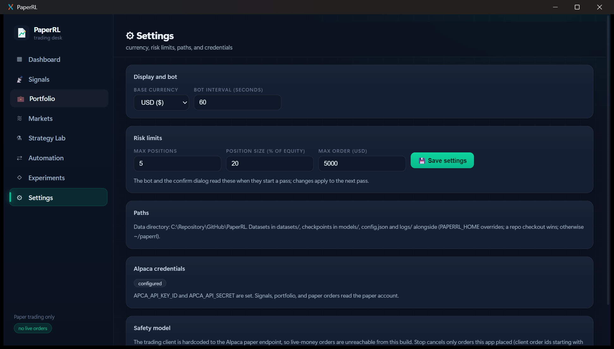

# Configuration

PaperRL reads credentials from the environment and everything else from `config.json` in its data directory. The desktop app and the CLI use the same resolution rules.

## Environment variables

| Variable | Purpose | Required |
|---|---|---|
| `APCA_API_KEY_ID` | Alpaca paper API key ID | for market data, account, portfolio, signals and orders |
| `APCA_API_SECRET` | Alpaca paper API secret | same as above |
| `PAPERRL_HOME` | Overrides the data directory | no |
| `RUST_LOG` | Log filter, for example `RUST_LOG=debug`; default `info` | no |

Training, backtesting and the Strategy Lab work offline from cached Parquet bars and do not need credentials.

## Data directory

Resolution order is fixed:

1. `PAPERRL_HOME`
2. A repository checkout, detected by a `datasets` directory beside the working directory
3. `~/paperrl` (`%USERPROFILE%\paperrl` on Windows), created on first launch

The directory uses this layout:

```
config.json
datasets/1day/<SYMBOL>.parquet
models/ppo-<SYMBOL>-<SEED>.bpk
models/ppo-<SYMBOL>-<SEED>.json
logs/app.log
logs/passes.jsonl
logs/orders.csv
```

Crypto pairs use a hyphen slug on disk: `BTC/USD` is `BTC-USD.parquet`.

## config.json

The app writes this file when you change settings. All fields are required when the file exists; a missing file starts from the defaults below.

```json
{
  "base_currency": "USD",
  "interval_secs": 3600,
  "watchlist": ["AAPL", "BTC/USD"],
  "risk": {
    "max_positions": 5,
    "position_pct": 0.2,
    "max_order_notional": 5000.0,
    "min_order_notional": 50.0
  }
}
```

| Field | Meaning | Default |
|---|---|---|
| `base_currency` | display currency, one of 18 codes; values convert through Alpaca FX rates | `USD` |
| `interval_secs` | bot pass interval; the desktop app enforces a minimum of 60 | `3600` |
| `watchlist` | tickers the in-app bot trades, stocks and crypto pairs | `[]` |
| `risk.max_positions` | maximum open positions | `5` |
| `risk.position_pct` | per-position cap as a fraction of equity (`0.2` is 20%) | `0.2` |
| `risk.max_order_notional` | maximum dollars per order | `5000` |
| `risk.min_order_notional` | orders below this amount are skipped as dust | `50` |

The Settings tab edits the same values. It shows position size as a percentage, while the file stores a fraction.

## CLI

Build the binary once:

```bash
cargo build --release -p paperrl-cli
```

On Windows it is `target\release\paperrl.exe`; on Linux and macOS it is `target/release/paperrl`. Add it to `PATH`, or substitute `cargo run -p paperrl-cli --` for `paperrl` below.

### Data

```bash
# Daily bars for stocks; needs paper keys
paperrl data sync --symbols AAPL,MSFT --years 3

# Inspect the newest cached bars
paperrl data show --symbol AAPL --limit 5
```

Sync accepts `1m`, `5m`, `15m`, `1h` and `1d` through `--timeframe`. Writes merge new bars into the existing Parquet file. `data sync` handles equities; crypto pairs are fetched and cached by the app's signal path.

### Train and evaluate

```bash
paperrl train --symbol AAPL --iters 300 --seed 42 --window 10

paperrl backtest --symbol AAPL \
  --strategies buyhold,ema,momentum,meanrev,voltarget,ppo \
  --model models/ppo-AAPL-42.bpk

paperrl backtest --symbol AAPL --strategies buyhold,voltarget,ppo \
  --model models/ppo-AAPL-42.bpk --window-months 6
```

Training writes `models/ppo-AAPL-42.bpk` and a JSON sidecar. Costs default to 1 bp fee and 5 bp slippage; override with `--fee-bps` and `--slippage-bps`. Backtest dates use `--start` and `--end` in `YYYY-MM-DD` form.

### Paper account

```bash
paperrl alpaca account
paperrl alpaca positions
paperrl alpaca bars --symbol AAPL --days 5
```

These commands use your Alpaca paper credentials and never reach live trading.

### Screener and automated passes

```bash
# Rank the most active 100 symbols; optionally train this year's top gainers
paperrl trade scan --top 100 --train-top 3 --iters 150 --since 2026-01-01

# Plan one pass without submitting orders
paperrl trade auto --top 100 --long 3

# Submit the plan to the paper account
paperrl trade auto --top 100 --long 3 --execute

# Repeat every five minutes
paperrl trade auto --top 100 --long 3 --execute --interval 300
```

A pass pulls the screener's most active symbols and current movers, refreshes stale bars, ranks by blended 20-day and 5-day momentum, sells positions whose momentum turned, and buys leaders within the risk gate. Liquidity filters drop names below $5 or under $2 million average daily dollar volume.

`--interval 0`, the default, runs a single pass. The paper endpoint is the only endpoint.

## Desktop app

| Tab | Workflow |
|---|---|
| Signals | type tickers, analyze, expand a verdict's reasons, place a paper Buy or Sell after confirming the notional |
| Portfolio | review holdings, weights, currency exposure, the equity curve and recent fills |
| Automation | start or stop the watchlist bot, set the interval, view pass history, run a dry-run or executed pass |
| Settings | base currency, interval, risk limits, data directory, credential status |



## Bot behavior

The in-app bot trades the watchlist saved from the Signals tab. Each pass checks the Alpaca clock: equity symbols are skipped while the market is closed, and crypto pairs are eligible at any hour. Every pass appends one JSON line to `logs/passes.jsonl` with what was planned, executed and skipped, and any errors.

Orders carry client order IDs that start with `paperrl-`. Stop cancels open orders with that prefix and leaves orders placed elsewhere untouched. Manual orders from the Signal dialog use the `paperrl-manual-` prefix. Submitted orders are also appended to `logs/orders.csv`.

The risk gate caps position count, position size, per-order notional and total spend by available cash. It never uses leverage, and symbols with open orders count as held, so a repeated pass cannot duplicate a buy.

## Known limits

- Leveraged single-stock ETFs such as TSLL and TSLG pass the price and volume filters and can dominate momentum rankings. There is no exclusion list yet, so do not treat paper results as investment evidence.
- Crypto signals use the rule vote only. No PPO checkpoint has been trained on crypto bars.
- Crypto bars are fetched by the Signals and bot paths, capped at 150 days per request. `data sync` is equities only.
- On the free Alpaca plan, FX rates can return HTTP 403. The app falls back to USD display with a visible note.
- `BarStore` is single-writer by convention. Do not run a desktop sync and a CLI sync against the same datasets at the same time.
- Orders submitted outside market hours are queued by Alpaca for the next session.
- The bot does not reconcile positions while the app is closed. There is no daemon.
- Credentials live in the environment and are never written to disk by PaperRL.

For the reward setup and strategy definitions, see [Strategies](strategies.md). For costs, walk-forward behavior and metric definitions, see [Backtesting](backtesting.md).
